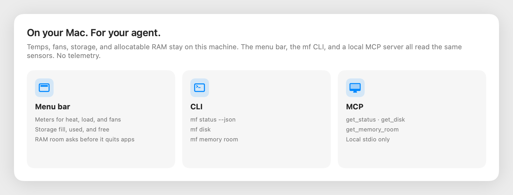
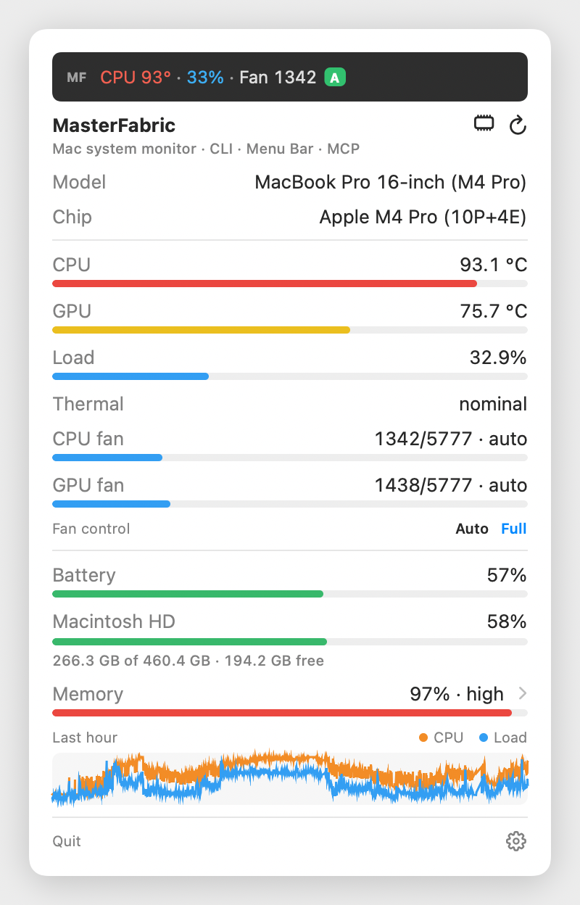
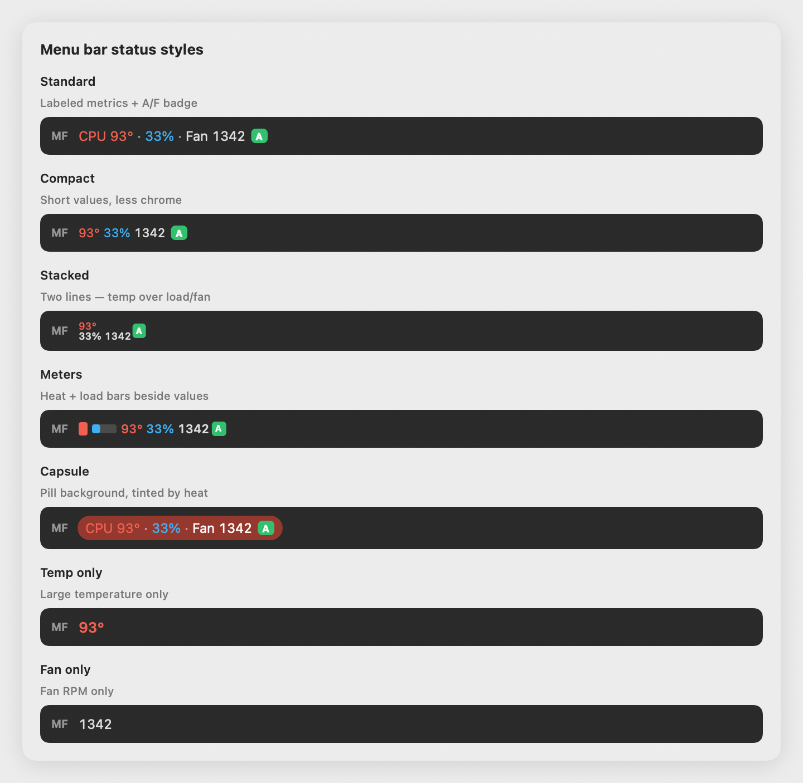
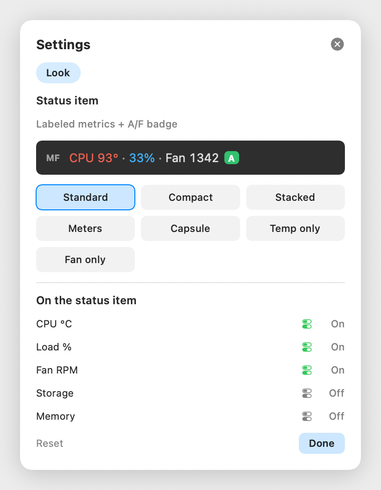
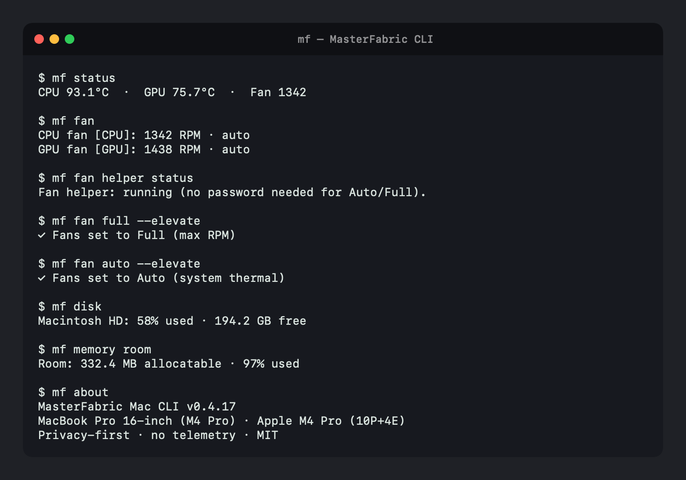

# MasterFabric Mac CLI

<p align="center">
  
</p>

> **Experimental open-source software.** Not affiliated with Slack, Telegram, Apple, or any third-party service. Sensors and configs stay on your Mac. **By using this tool you accept responsibility** for how you run it, what credentials you store, and any effects on your machine or connected accounts.

> MacBook system monitor with a first-class **MCP** server — so Cursor, Claude, and any agent can read CPU/GPU temps, fans, battery, and more on your machine.

[](LICENSE)
[](https://github.com/masterfabric/masterfabric-mac-cli)
[](https://github.com/masterfabric/masterfabric-mac-cli#mcp--agent-ready)
[](Package.swift)
[](README.md)

**Repo:** [github.com/masterfabric/masterfabric-mac-cli](https://github.com/masterfabric/masterfabric-mac-cli)

Native Swift · Apple Silicon first · **No telemetry** · AGPL-3.0

---

## Why MasterFabric?



Temps, fans, storage, and allocatable RAM stay on this Mac. The menu bar, the `mf` CLI, and a local MCP server read the same sensors. Nothing is uploaded.

| Surface | What you get |
|--------|----------------|
| **Menu bar** | Meters for heat, load, and fans. A storage fill bar. RAM room asks before it quits apps. |
| **CLI (`mf`)** | The same metrics as `--json`, including `mf disk` and `mf memory room`. |
| **MCP** | `get_status`, `get_disk`, `get_memory_room`, and the rest, over local stdio. |

---

## What's new in 0.4.17

**Storage** shows how full the startup volume is.

The menu bar dropdown lists the volume name, a fill bar, and used / total / free space. The bar turns amber from 75% and red from 90%. Settings → **Storage** also puts `Disk 72%` on the status strip.

```bash
mf disk
mf disk --json
```

`menubar.panel_disk` defaults to on. `menubar.show_disk` defaults to off.

## What's new in 0.4.16

**RAM room** shows how many bytes a new model can still allocate, then frees that space one app at a time.

macOS “free” memory is not the same number a model can take. Room uses `os_proc_available_memory`: cached memory macOS can reclaim counts; wired and compressed memory does not. The menu bar draws that number live for 60 seconds, with your target as a dashed line.

| Surface | What it does |
|---------|----------------|
| **Menu bar** | Memory-chip button, or the Memory row. **− / +** sets the target (default **8 GB**, saved as `menubar.model_room_target_gb`, range 1–32). **Make N GB** quits the largest eligible apps until that much is allocatable. **Stop** halts. **Free**, then **Quit**, releases one row. |
| **CLI** | `mf memory room`, `mf memory make`, `mf memory free --pid <PID>` |
| **MCP** | `get_memory_room`, `release_memory` |

**Make room** sends a normal quit (`SIGTERM`), one process at a time, and skips anything under 64 MB. It leaves these running:

- Cursor itself
- Model runtimes (Ollama, llama.cpp, LM Studio, MLX, vLLM, GPT4All)
- System processes, Tailscale, and this menu bar

You can still quit a model runtime or Cursor from a single **Free** row. `mf memory free --force` sends `SIGKILL` and is CLI-only. A quit can discard unsaved work in that app if the app does not save on exit.

```bash
mf memory room
mf memory room --limit 10 --json
mf config set menubar.model_room_target_gb 16
mf memory make
mf memory free --pid 1234
mf memory free --pid 1234 --force
```

Process sampling also no longer stalls when `ps` fills its error pipe, so top processes and RAM room stay responsive on a busy Mac.

---

## MCP — agent-ready

MasterFabric speaks **Model Context Protocol** out of the box. Point Cursor or Claude Desktop at one binary:

```bash
mf mcp
```

**Cursor** — add to `~/.cursor/mcp.json`:

```json
{
  "mcpServers": {
    "masterfabric": {
      "command": "/Users/YOU/.local/bin/mf",
      "args": ["mcp"]
    }
  }
}
```

Copy-paste starter: [examples/mcp.json](examples/mcp.json)

### Tools agents can call

| Tool | Returns |
|------|---------|
| `get_status` | CPU/GPU °C + fan RPM |
| `get_temp` / `get_fan` | Temps or fans (CPU + GPU roles) |
| `set_fan_mode` | `auto` or `full` (max RPM) for both fans |
| `get_info` | Model, chip (P+E cores), macOS, RAM, uptime |
| `get_battery` | %, health, cycles, watts |
| `get_memory` / `get_disk` / `get_network` | Host metrics |
| `get_memory_room` | Allocatable RAM (`availableBytes`), quittable RSS, and the largest processes. Optional `limit` (default 20) |
| `release_memory` | Quit one process by `pid`. Default signal is `SIGTERM`; `force: true` sends `SIGKILL`. Refuses pid 1, this process, system daemons, Tailscale, and the menu bar |
| `get_cpu_load` | Overall + P/E cluster + per-core % |
| `get_power` | Thermal state, Low Power Mode |
| `get_top` / `get_history` | Hot processes + 1h sparklines |
| `set_alert_threshold` | Update `config.toml` alerts |
| `check_version` | Local vs GitHub open-source version |
| `run_update` | Upgrade from GitHub install script (JSON) |
| `get_about` | Version + privacy |

**Resource:** `masterfabric://status` — live JSON snapshot.

> Your sensors never leave the Mac. MCP is **local stdio** only — no cloud relay.

---

## Install (CLI)

**One-liner:**

```bash
curl -fsSL https://raw.githubusercontent.com/masterfabric/masterfabric-mac-cli/main/scripts/install.sh | bash
```

**From source:**

```bash
git clone https://github.com/masterfabric/masterfabric-mac-cli.git
cd masterfabric-mac-cli
make install
export PATH="$HOME/.local/bin:$PATH"
```

**Verify:**

```bash
mf --version
mf status
mf menubar
```

Requires macOS 13+ and Swift (Xcode or CLT). Apple Silicon recommended.

Homebrew formula (tap after tagging a release): [`Formula/masterfabric.rb`](Formula/masterfabric.rb)

---

## Menu Bar

Live status item. Click it for meters, storage, RAM, **Fan Auto/Full**, and **Settings** (gear next to Quit). Alerts and integrations live in Settings.



### Display settings & styles

Open the panel → gear next to **Quit**. Choose a status style and toggle what appears in the strip and dropdown.

| Style | Look |
|-------|------|
| **Standard** | CPU · load · fan + green **A** / blue **F** badge |
| **Compact** | Short values, less chrome |
| **Stacked** | Temperature over load and fan |
| **Meters** | Heat and load bars beside the values |
| **Capsule** | Dark pill, tinted by heat |
| **Temp only** | Just degrees, e.g. `52°` |
| **Fan only** | Just RPM |





```bash
mf menubar          # launch
mf login enable     # start at login
```

App bundle: `~/.local/MasterFabricMenuBar.app` (no Dock icon).

- **Fan control** — **Auto** / **Full** for CPU + GPU fans (one-time admin helper install)
- **RAM room** — memory-chip button, or the Memory row. Allocatable bytes, a 60-second graph, and a **Make N GB** target. See [What's new in 0.4.16](#whats-new-in-0416).
- **Storage** — startup volume fill bar (used percent, used of total, free). Settings → **Storage** also puts `Disk 72%` on the status strip (`menubar.show_disk`, `menubar.panel_disk`). See [What's new in 0.4.17](#whats-new-in-0417).
- **Settings** — gear next to Quit; saved under `[menubar]` in `config.toml`
- **Local notifications** — Settings → **Notifications** (top): off by default; turning On asks macOS for permission; **Test notification** sends a sample banner (`alerts.notify_local`)
- **Alerts** — tap thermometer / GPU / fan / memory / disk / battery / power icons to edit thresholds; optional **Send to Integrations**
- **Integrations** — Slack · Telegram · Mail with on/off toggles, Edit, and circle brand badges (configure without the terminal via **+**)

---

## CLI

Scriptable metrics with `--json`. Example session (status, fan helper, Auto/Full):



```bash
mf status
mf cpu
mf memory
mf memory room
mf memory make
mf notify status
mf bot --help
mf about
```

### Cheat sheet

```text
mf status | temp | fan | fan auto | fan full | info
```

Fan control (`mf fan auto` / `mf fan full`) writes SMC keys and usually needs elevation:

```text
# Recommended (menu bar / one-time admin helper):
mf fan helper install          # password once
mf fan full --elevate
mf fan auto --elevate

# Or classic sudo each time:
sudo mf fan full
sudo mf fan auto
```

Menu Bar **Auto** / **Full** installs a root helper the first time (one password), then switches without prompting again.

```text
mf battery | memory | memory room | memory make | memory free --pid <PID> [--force] | disk | network | cpu
mf power | top | history | watch
mf check [--notify]
mf notify status | test | send --channel slack "hello"
mf bot telegram
mf version [--check] [--json]
mf update [--force] [--json]
mf config show | init | set <key> <value>
mf login enable | disable | status
mf about [--lang en|tr]
mf menubar
mf mcp
```

All read commands support `--json`.

---

## Integrations — Slack · Telegram · Mail

Optional notification channels you configure yourself. MasterFabric is **not** an official product of these services.

<p align="center">
  
  &nbsp;&nbsp;&nbsp;
  
  &nbsp;&nbsp;&nbsp;
  
</p>

<p align="center">
  <strong>Slack</strong>
  &nbsp;&nbsp;&nbsp;&nbsp;&nbsp;&nbsp;&nbsp;&nbsp;&nbsp;&nbsp;
  <strong>Telegram</strong>
  &nbsp;&nbsp;&nbsp;&nbsp;&nbsp;&nbsp;&nbsp;&nbsp;
  <strong>Mail</strong>
</p>

| | Channel | What you provide |
|---|---------|------------------|
|  | **Slack** | Incoming webhook URL |
|  | **Telegram** | Bot token + numeric chat id |
|  | **Mail** | `resend` / `mailgun` API key, or `smtp` |

Push alerts (or any message) to chat/email from the CLI, menu bar, or MCP. Tokens stay in `~/.config/masterfabric/config.toml` — never commit them.

```bash
mf config init
mf config set integrations.slack.enabled true
mf config set integrations.slack.webhook_url "https://hooks.slack.com/services/…"

mf config set integrations.telegram.enabled true
mf config set integrations.telegram.bot_token "123:ABC"
mf config set integrations.telegram.chat_id "987654321"

mf config set integrations.mail.enabled true
mf config set integrations.mail.provider resend   # or smtp | mailgun
mf config set integrations.mail.from "alerts@example.com"
mf config set integrations.mail.to "you@example.com"
mf config set integrations.mail.api_key "re_xxx"

mf notify test --channel all
mf check --notify
mf notify send --channel slack "CPU spike on build machine"
```

Full sample: [examples/integrations.toml](examples/integrations.toml)

MCP tools: `notify_send`, `notify_status`.

### Telegram interactive bot (Q&A)

Keep a process running on the Mac so the bot can answer questions with live metrics:

```bash
mf bot telegram
```

Then in Telegram:

```text
/status
/temp
/fan
/battery
how's the fan?
cpu load?
```

Only the configured numeric `chat_id` is allowed. Ctrl+C stops the listener.

---

## Version

Single source of truth: root [`VERSION`](VERSION) (synced into `AppVersion.current` on build).

```bash
mf version              # local
mf version --check      # compare to the GitHub release (masterfabric/masterfabric-mac-cli)
mf version --check --json
mf update               # install that release tag, then reopen the menu bar if it was running
mf update --force       # reinstall the current release
mf update --json        # machine-readable result
```

`mf update` clones the published tag, builds it, and installs into `~/.local`. The menu bar quits before its binary is replaced, then opens again. A failure stays on screen and in `~/.local/share/masterfabric/update.log`.

Exit code `2` means an update is available. Install from source:

```bash
curl -fsSL https://raw.githubusercontent.com/masterfabric/masterfabric-mac-cli/main/scripts/install.sh | bash
```

Bump a release: edit `VERSION`, run `make version-sync`, commit, tag `vX.Y.Z`.

---

`~/.config/masterfabric/config.toml` — language, poll interval, alert thresholds, launch-at-login.

```bash
mf config init
mf config set alerts.cpu_temp_celsius 88
mf config set menubar.model_room_target_gb 16
```

**Privacy-first:** readings stay on-device. No analytics, no accounts, no network calls for core monitoring.

---

## Open source

- **License:** [GNU AGPL-3.0](LICENSE) — same family as [OSMEA](https://github.com/masterfabric-mobile/osmea) and [masterfabric_core](https://github.com/masterfabric-mobile/masterfabric_core)
- **Contributing:** [CONTRIBUTING.md](CONTRIBUTING.md) · commits in [commits.md](commits.md)
- **Security:** [SECURITY.md](SECURITY.md) · conduct: [CODE_OF_CONDUCT.md](CODE_OF_CONDUCT.md)
- **Issues / PRs:** welcome at [masterfabric/masterfabric-mac-cli](https://github.com/masterfabric/masterfabric-mac-cli)
- **Stack:** SwiftPM · IOKit/SMC · SwiftUI `MenuBarExtra` · MCP JSON-RPC stdio

```bash
swift build
swift run mf status
make install
```

---

## License

GNU Affero General Public License v3.0 © MASTERFABRIC Bilişim Teknoloji A.Ş. and contributors.

You can use, modify, and share this program under AGPL-3.0. If you run a modified version as a network service, you must offer the corresponding source to its users. See [LICENSE](LICENSE).
